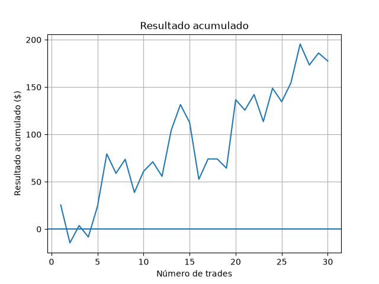

# Analisador de Trades

Meu quarto projeto em Python. Lê um CSV com o histórico de operações de trading, calcula as principais métricas de desempenho e gera um gráfico de resultado acumulado. É o primeiro projeto em que uso as bibliotecas **pandas** e **matplotlib**.

## O que o programa faz

- Conta os trades e calcula o resultado total e a média por trade
- Encontra o maior ganho e a maior perda
- Calcula a quantidade de trades vencedores e a taxa de acerto
- Agrupa o resultado por ativo (soma, média e quantidade) e indica o ativo mais lucrativo
- Calcula o pico do saldo e o drawdown máximo (maior queda a partir de um pico)
- Gera o gráfico de resultado acumulado e o salva como imagem



## Exemplo de entrada

O arquivo `trades_exemplo.csv` traz 30 trades fictícios no formato:

```
ativo,direcao,resultado
EURUSD,C,25.5
XAUUSD,V,-40.0
```

## Como executar

Requisitos: Python 3 e as bibliotecas pandas e matplotlib.

```
python -m pip install pandas matplotlib
python analise.py
```

O programa procura o CSV na mesma pasta do script, então pode ser executado de qualquer lugar.

## O que pratiquei

- Leitura de CSV com `pandas` e noções de `DataFrame` e `Series`
- Métricas de coluna: `.sum()`, `.mean()`, `.max()`, `.min()`
- Filtros e contagem com condições (`df["resultado"] > 0`)
- Acumulados com `.cumsum()` e `.cummax()`
- Agrupamento com `groupby` e `agg`, e ordenação com `sort_values`
- Gráficos com `matplotlib` (`plot`, títulos, eixos, `savefig` e `show`)
- Caminhos de arquivo independentes de onde o programa roda (`__file__` e `os.path`)
- Conferência dos resultados contra valores de referência calculados à mão

## Próximos passos

- Tratar o ponto de partida do saldo no cálculo do drawdown
- Ler o arquivo de trades do projeto 3 (`trades.csv`) diretamente
- Destacar o drawdown no gráfico
